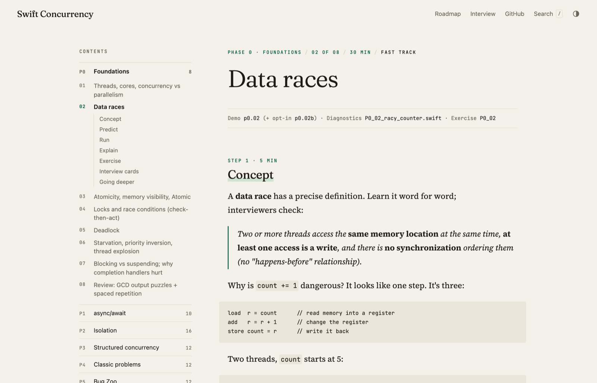

# Swift Concurrency, From First Principles

86 half-hour sessions that teach Swift concurrency by making you predict what a program does, run it, and explain why you were wrong. You start with threads and a counter that loses updates, and finish with actors, structured concurrency, real bug reports and senior iOS interview rounds.

**Read it as a book: [silver-syrniki-b3d81b.netlify.app](https://silver-syrniki-b3d81b.netlify.app)**

[](https://github.com/Zulqarnayn/Swift-Concurrency-From-First-Principles/actions/workflows/site-check.yml)



## What's inside

- **P0 Foundations** (8 sessions). Threads, cores, data races, atomics, locks, deadlock and thread explosion, starting from GCD.
- **P1 async/await** (10). What `await` really does, the cooperative pool, tasks, continuations and async sequences.
- **P2 Isolation** (16). Actors, reentrancy, `@MainActor`, `Sendable`, `sending`, and the Swift 6 errors you will actually meet.
- **P3 Structured concurrency** (12). `async let`, task groups, bounded concurrency, cancellation, timeouts and task-locals.
- **P4 Classic problems** (12). Producer and consumer, readers and writers, semaphores, rate limits, single-flight, an image pipeline.
- **P5 Bug Zoo** (12). Real bug reports with no hints. Reproduce, make it deterministic, find the cause, prove the fix.
- **P6 Internals** (8). Executors, what tasks and hops cost when measured, the memory model, Swift Evolution.
- **P7 Interview mastery** (8). Output marathons, timed katas, system design rounds and a full mock interview.

Each session is a markdown file in `lessons/`, a demo you run, and an exercise graded by a test. The [roadmap](ROADMAP.md) has the full checklist, the interview fast track and a cheat sheet of the scripts.

## Quick start

```bash
git clone https://github.com/Zulqarnayn/Swift-Concurrency-From-First-Principles.git
cd Swift-Concurrency-From-First-Principles/ConcurrencyLab
swift run lab p0.01            # the demo for session P0.01
swift test --filter P0_01      # grades its exercise; fails until you solve it
```

Then open [`lessons/P0-foundations/01-threads-cores.md`](lessons/P0-foundations/01-threads-cores.md), or the same page on the site.

## How the repository is laid out

```
lessons/P0…P7/        the sessions, one markdown file each
ConcurrencyLab/       Swift package: demos (swift run lab <id>), your exercises, the tests that grade them,
                      Diagnostics/ (files whose compiler errors are the lesson) and Fixme/ exercises
ConcurrencyLabApp/    SwiftUI app for the iOS labs (xcodegen generate)
solutions/            reference solutions, same file names as the exercises
interview/            flashcards, question bank, output puzzles, timed katas
reading-list.md       Massicotte, Apple docs, WWDC sessions, Swift Evolution, books
scripts/              typecheck, stress, strict-pool, verify-solutions, and the site build
site/                 theme and home page of the course website
```

## Requirements

Xcode 26 or later (Swift 6.2+). The course was built and verified with Swift 6.3.3, Xcode 26.6 and macOS 26.5. The iOS labs also need [XcodeGen](https://github.com/yonaskolb/XcodeGen).

To build the website locally: `python3 -m venv .venv-site && .venv-site/bin/pip install -r site/requirements.txt`, then `.venv-site/bin/python scripts/build-site.py --serve`.

## License

The code (the Swift package, the app, solutions and scripts) is under the [MIT License](LICENSE). The lesson text (`lessons/`, `interview/`, `ROADMAP.md`, `reading-list.md` and the site's home page) is under [CC BY-NC-SA 4.0](LICENSE-CONTENT): share and adapt it for non-commercial use, with credit, under the same terms. The fonts in `site/theme/fonts/` are under the SIL Open Font License.

## Credits

Phase P2 follows Matt Massicotte's writing on [massicotte.org](https://www.massicotte.org), and his articles are linked from the lessons that use them. The reading list credits the Apple documentation, WWDC sessions, Swift Evolution proposals and books the course draws on.
